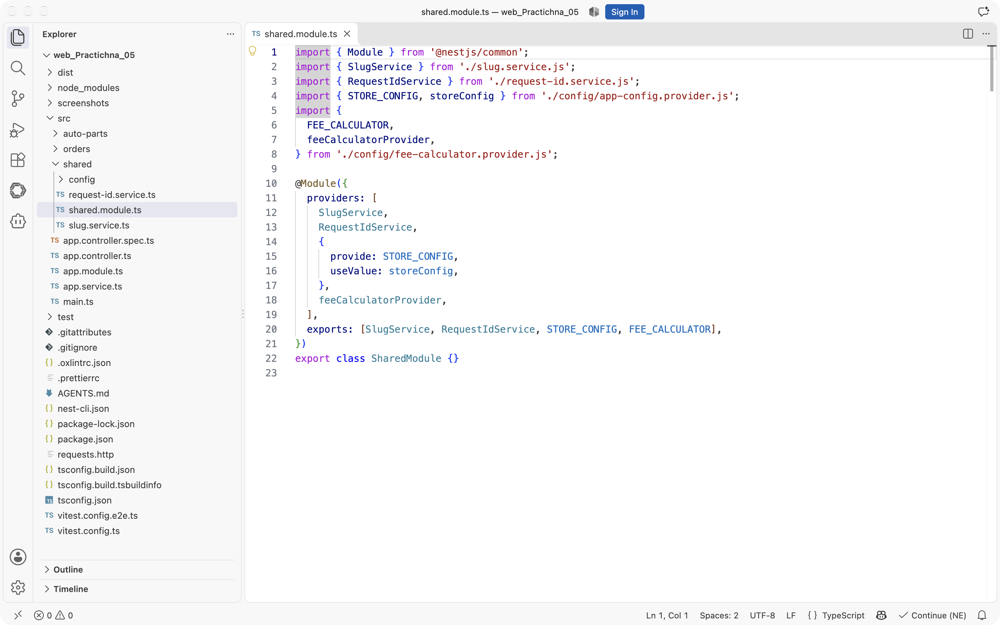
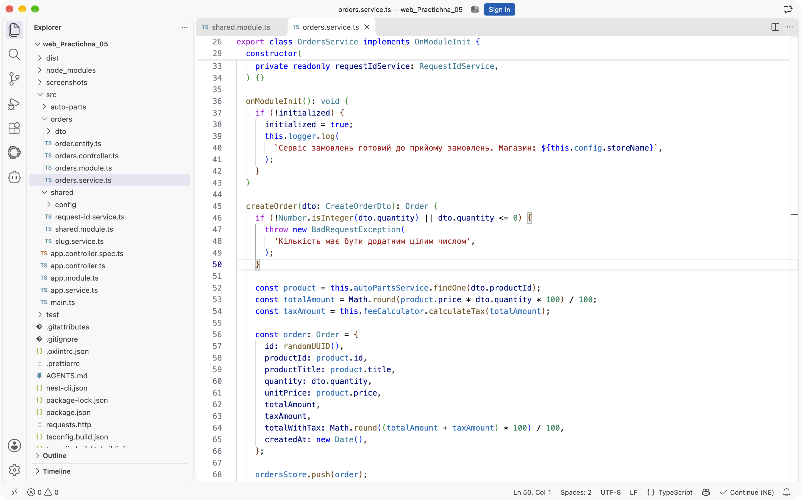
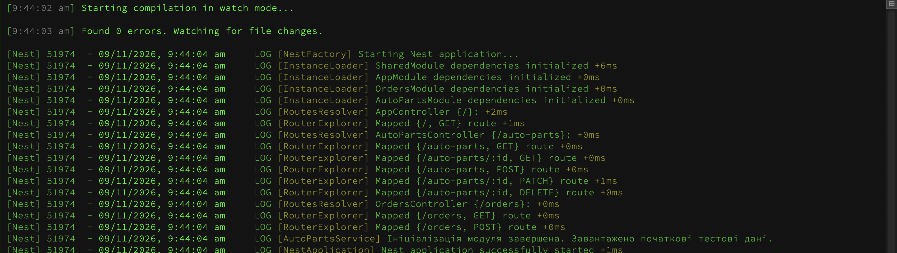
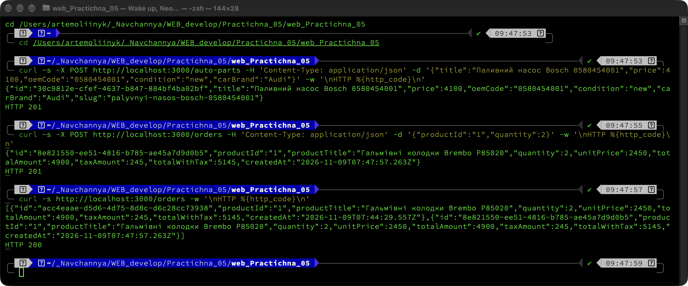
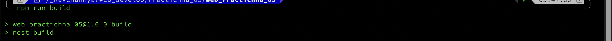

# Практична робота № 5

## Модульна архітектура та ін'єкція залежностей у NestJS

**Виконав:** Олійник Артем Сергійович
**Курс:** IV
**Група:** КН-43
**Дисципліна:** WEB-розробка
**Варіант:** 7 (автозапчастини, `AutoPartsModule`)
**Рік:** 2026

---

## Мета роботи

- Розділити застосунок на слабко зв'язані модулі з чіткими межами відповідальності.
- Передавати залежності через конструктори та custom providers.
- Дослідити життєвий цикл модулів і область видимості провайдерів.

## Середовище виконання

| Компонент | Версія |
|---|---|
| Node.js | 26.9.0 |
| npm | 11.19.1 |
| NestJS | 11 |
| TypeScript | 5.9 |
| ОС | macOS 26 |

## Структура проєкту

```text
web_Practichna_05/
├── src/
│   ├── auto-parts/
│   │   ├── dto/
│   │   ├── auto-part.entity.ts
│   │   ├── auto-parts.controller.ts
│   │   ├── auto-parts.service.ts
│   │   └── auto-parts.module.ts
│   ├── orders/
│   │   ├── dto/create-order.dto.ts
│   │   ├── order.entity.ts
│   │   ├── orders.controller.ts
│   │   ├── orders.service.ts
│   │   └── orders.module.ts
│   ├── shared/
│   │   ├── config/
│   │   │   ├── app-config.provider.ts
│   │   │   └── fee-calculator.provider.ts
│   │   ├── request-id.service.ts
│   │   ├── slug.service.ts
│   │   └── shared.module.ts
│   ├── app.module.ts
│   └── main.ts
├── requests.http
├── screenshots/
├── package.json
└── README.md
```

---

## Хід виконання

### Рівень 1. Feature Module та Shared Module

Структуру створено через NestJS CLI:

```bash
npx nest g module shared --no-spec
npx nest g module orders --no-spec
npx nest g controller orders --no-spec
npx nest g service orders --no-spec
```

`AppModule` тепер містить лише імпорти модулів, без контролерів і сервісів предметної області:

```ts
@Module({
  imports: [AutoPartsModule, SharedModule, OrdersModule],
  controllers: [AppController],
  providers: [AppService],
})
export class AppModule {}
```

`SharedModule` надає чотири провайдери: `SlugService`, `RequestIdService`, конфігурацію `STORE_CONFIG` і калькулятор комісії `FEE_CALCULATOR`.

```ts
@Module({
  providers: [
    SlugService,
    RequestIdService,
    { provide: STORE_CONFIG, useValue: storeConfig },
    feeCalculatorProvider,
  ],
  exports: [SlugService, RequestIdService, STORE_CONFIG, FEE_CALCULATOR],
})
export class SharedModule {}
```

`SlugService` транслітерує українські літери, очищає рядок від зайвих символів і замінює пробіли дефісами:

```ts
generateSlug(title: string): string {
  const normalized = title.trim().toLowerCase();

  const transliterated = [...normalized]
    .map((char) => TRANSLITERATION[char] ?? char)
    .join('');

  return transliterated
    .replace(/['’]/g, '')
    .replace(/[^a-z0-9]+/g, '-')
    .replace(/^-+|-+$/g, '')
    .replace(/-{2,}/g, '-');
}
```

`AutoPartsModule` імпортує `SharedModule`, використовує `SlugService` у сервісі та експортує `AutoPartsService` для інших модулів:

```ts
@Module({
  imports: [SharedModule],
  controllers: [AutoPartsController],
  providers: [AutoPartsService],
  exports: [AutoPartsService],
})
export class AutoPartsModule {}
```

Під час створення автозапчастини поле `slug` формується автоматично:

```ts
create(dto: CreateAutoPartDto): AutoPart {
  const item: AutoPart = {
    id: randomUUID(),
    ...dto,
    slug: this.slugService.generateSlug(dto.title),
  };
  this.items.push(item);
  return item;
}
```



### Рівень 2. Міжмодульна взаємодія та Custom Providers

`OrdersModule` імпортує `AutoPartsModule` і `SharedModule`. `OrdersService` отримує каталог, калькулятор комісії, конфігурацію та сервіс ідентифікатора запиту через конструктор:

```ts
constructor(
  private readonly autoPartsService: AutoPartsService,
  @Inject(FEE_CALCULATOR) private readonly feeCalculator: FeeCalculator,
  @Inject(STORE_CONFIG) private readonly config: StoreConfig,
  private readonly requestIdService: RequestIdService,
) {}
```

Конфігурація описана стратегією `useValue`:

```ts
export const STORE_CONFIG = 'STORE_CONFIG';

export interface StoreConfig {
  storeName: string;
  defaultCurrency: string;
  taxPercent: number;
}

export const storeConfig: StoreConfig = {
  storeName: 'AutoParts Store',
  defaultCurrency: 'UAH',
  taxPercent: 5,
};
```

Комісія описана стратегією `useFactory`: фабрика отримує `STORE_CONFIG` через `inject` і повертає об'єкт із методом `calculateTax`:

```ts
export const feeCalculatorProvider: Provider = {
  provide: FEE_CALCULATOR,
  useFactory: (config: StoreConfig): FeeCalculator => ({
    calculateTax: (amount: number): number =>
      Math.round(amount * config.taxPercent) / 100,
  }),
  inject: [STORE_CONFIG],
};
```

Створення замовлення перевіряє товар через `AutoPartsService.findOne`, множить ціну на кількість і додає податок:

```ts
const product = this.autoPartsService.findOne(dto.productId);
const totalAmount = Math.round(product.price * dto.quantity * 100) / 100;
const taxAmount = this.feeCalculator.calculateTax(totalAmount);
```

Для товару `id: 1` і кількості `2` виходить `4900 грн`, податок `245 грн`, разом `5145 грн`.



### Рівень 3. Lifecycle Hooks та Scope

`AutoPartsService` реалізує `OnModuleInit`, виводить повідомлення через `Logger` і додає дві початкові сутності зі згенерованими `slug`:

```ts
onModuleInit(): void {
  this.logger.log(
    'Ініціалізація модуля завершена. Завантажено початкові тестові дані.',
  );

  for (const item of initialItems) {
    this.items.push({
      id: randomUUID(),
      slug: this.slugService.generateSlug(item.title),
      ...item,
    });
  }
}
```

`OrdersService` також реалізує `OnModuleInit` і повідомляє про готовність до прийому замовлень.

`RequestIdService` має `Scope.REQUEST`, тому кожен HTTP-запит отримує новий ідентифікатор. Сервіс впроваджено в контролери `AutoPartsController` та `OrdersController`, а також у `OrdersService`. Оскільки `OrdersService` став request-scoped, сховище замовлень винесено на рівень модуля, щоб замовлення не зникали між запитами:

```ts
const ordersStore: Order[] = [];
let initialized = false;
```

У журналі сервера видно різні `requestId` для послідовних запитів, а також повідомлення про ініціалізацію модулів:



Перевірка модульної взаємодії через `curl`:

```bash
curl -X POST http://localhost:3000/auto-parts \
  -H "Content-Type: application/json" \
  -d '{"title":"Паливний насос Bosch 0580454001","price":4100,"oemCode":"0580454001","condition":"new","carBrand":"Audi"}'

curl -X POST http://localhost:3000/orders \
  -H "Content-Type: application/json" \
  -d '{"productId":"1","quantity":2}'

curl http://localhost:3000/orders
```

Створена автозапчастина отримує `slug: "palyvnyi-nasos-bosch-0580454001"`, замовлення повертає `201 Created` і суму `5145 грн`, а список замовлень зберігає обидва створені записи.



## Результати перевірки

| Перевірка | Очікування | Фактично | Результат |
|---|---|---|---|
| `GET /auto-parts` | 5 початкових записів | 5 записів після `OnModuleInit` | успішно |
| `POST /auto-parts` | `201` і `slug` | `201`, `palyvnyi-nasos-bosch-0580454001` | успішно |
| `POST /orders` з `productId: 1` | `201`, сума з податком | `201`, `4900 + 245 = 5145` | успішно |
| `POST /orders` з неіснуючим товаром | `404` | `404` | успішно |
| `GET /orders` | список замовлень | 2 замовлення | успішно |
| `OnModuleInit` каталогу | повідомлення в лозі | повідомлення присутнє | успішно |
| `RequestIdService` | різні `id` на запит | різні `id` у лозі | успішно |
| `npm run build` | без помилок | 0 помилок | успішно |

Компіляція проєкту:



## Висновки

Розподіл на `AutoPartsModule`, `OrdersModule` і `SharedModule` прибрав прямі залежності між контролерами та сторонніми сервісами. `OrdersModule` знає лише про експортований `AutoPartsService`, а спільні утиліти отримує з `SharedModule`.

Custom providers дали змогу передати конфігурацію через `useValue`, а калькулятор комісії зібрати через `useFactory` з ін'єкцією цієї конфігурації. Завдяки цьому відсоток податку змінюється в одному місці, а сервіс замовлень не знає, як саме він обчислюється.

`OnModuleInit` зручно використовувати для початкового наповнення сховища та перевірки готовності модуля. `Scope.REQUEST` показав, що новий екземпляр провайдера створюється на кожен запит, а стан, який має пережити запит, потрібно зберігати поза таким провайдером.

## Інструкція запуску

```bash
npm install
npm run start:dev
```

Сервер доступний за адресою `http://localhost:3000`. Перевірка:

```bash
curl http://localhost:3000/auto-parts
curl http://localhost:3000/orders
```

Файл `requests.http` містить готові запити для VS Code REST Client.
